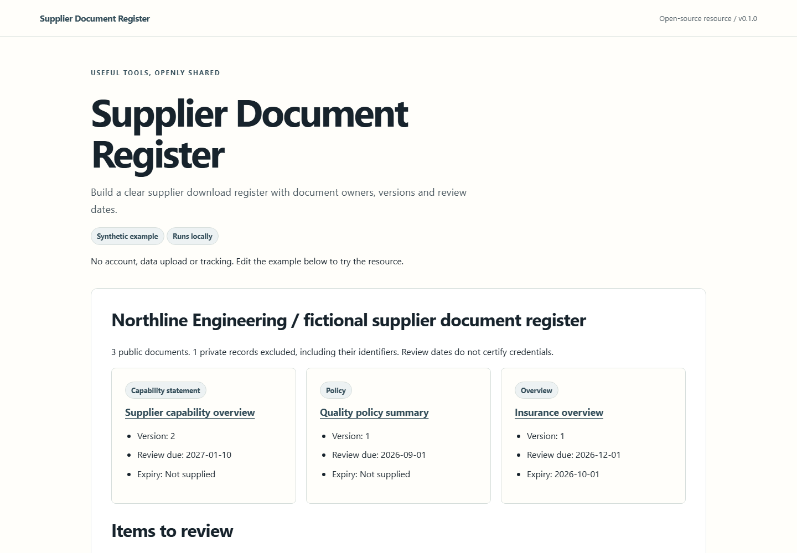

# Supplier Document Register

Supplier Document Register turns an approved document list into a readable website downloads section. It also produces a review queue so each document has an owner and a clear next check date.

Files stay on your own computer and hosting. The register does not certify a supplier's credentials. Maintained by [Aberdeen Web Design](https://webdesignaberdeen.uk/), operated by JW Digital Services Ltd.



## Start locally

Requires Node.js 22 or later. No runtime dependencies or account required.

```sh
npm ci
npm test
npm run build
npm run serve
```

Open http://127.0.0.1:4173/ for the complete local demonstration. Browser examples do not upload or persist entered data. The optional development server binds to loopback only.

## Input and output

Supply supplier, asOf and documents: id, title, url, document_type, version, owner, review_due, public (boolean). Optional expires_on is different from review_due. Private records never enter publication output.

Use [examples/input.json](examples/input.json) as the complete input contract. Compare the generated [JSON result](examples/output.json), [Markdown report](examples/output.md) and [complete HTML](examples/output.html). The demo is in [demo/index.html](demo/index.html). It needs the local server for JavaScript modules. HTML reports can be opened as standalone files.

```sh
node cli.mjs examples/input.json --format json
node cli.mjs examples/input.json --format html --output report.html
node cli.mjs examples/input.json --format md --output report.md
```

Flat collections can also be imported with `--csv data.csv --context context.json --key items` (replace `items` with the documented collection). Nested structures use JSON. See `node cli.mjs --help`.

## Worked example

Use a fictional engineering supplier with a capability statement, a quality policy, an insurance overview and one private internal document. Include a superseded duplicate version and a record without a review owner. The private document must appear only in the local maintenance report, never the public HTML or public example export. Use entirely synthetic files and example.com links.

All supplied example records are synthetic. No clients, outcomes, current professional advice or real service availability are represented by them. Keep real records private and review output before sharing it.

## Checks

- Private records are excluded from every public output, including hidden data, metadata and generated search indexes.
- Duplicate IDs fail visibly. Version changes do not replace unrelated records.
- Dates have an explicit format and deterministic test clock. Missing expiry and expired documents are different states.
- Unsafe link schemes and markup in CSV fields cannot inject executable HTML.
- Download lists work at 320 px, by keyboard and without JavaScript. A real file size is shown only when supplied or measured.

The automated results and browser checks performed for this release are recorded in [verification.md](docs/verification.md). Manual screen-reader testing has not been performed. A passing automated check is not accessibility certification.

## Contribute and maintain

Use [Issues](https://github.com/Web-Design-Aberdeen/supplier-document-register/issues) for a reproducible bug and [Discussions](https://github.com/Web-Design-Aberdeen/supplier-document-register/discussions) for questions and improvements. Follow [CONTRIBUTING.md](CONTRIBUTING.md); report vulnerabilities privately using [SECURITY.md](SECURITY.md). See [CHANGELOG.md](CHANGELOG.md) for releases. Maintenance is best effort.

Code, original illustrations and synthetic fixtures are MIT licensed. There is no required website backlink when reusing the resource. Commercial brand assets and third-party material are not included.

## CSV example

```sh
node cli.mjs --csv examples/input.csv --context examples/context.json --key documents --format html --output csv-report.html
```

The context holds the root settings; the CSV holds the flat collection. Explicit booleans use `true` or `false`. Nested data uses JSON.
